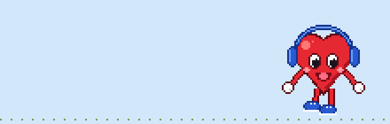

# Mascotas en pantalla

App Android con mascotas de los 90 (eSheep, Neko, zorritos...) que caminan
**por encima de todas tus apps**, como el clásico eSheep de Windows.
Es un port a Kotlin del motor de [desktopPet](https://github.com/Adrianotiger/desktopPet)
(versión 1.6.0, commit `f86f303`, licencia MIT) y usa sus mismos archivos `animations.xml`.

- Arrastra la mascota con el dedo, lánzala y verás cómo rebota y cae.
- **Tócala** para acariciarla: se alegra y le salen corazones.
- **Dar de comer** (en la app o manteniendo pulsado su icono): cae comida y van a por ella; arrastra la comida para llevarlas donde quieras.
- Toca dos veces para despedirla.
- Si pones varias, reaccionan al chocar entre sí: las eSheep se dan la vuelta, rebotan
  o se echan a dormir junto a la que ya duerme; las demás se dan la vuelta o siguen de largo.
- Desde la notificación: **Otra más** o **Quitar todas**.
- **Velocidad**: Lenta, Tranquila, Normal o Rápida, para todas a la vez.
- **Probar movimientos**: elige cualquiera de los movimientos del XML (con buscador) y la
  mascota lo hace al momento; puede repetirlo y mostrar su nombre encima. Es un modo aparte:
  mientras pruebas, tus mascotas se esperan ocultas y sólo se mueve la de prueba.
- **Editar mascotas**: cambia los dibujos, la velocidad, el avance y las repeticiones de cada
  movimiento, con vista previa en vivo; en "Opciones avanzadas", qué hace después, sus crías y su sonido. Las incluidas se guardan como copia "(mía)".
- **Sonidos** (si la mascota los trae): se encienden y apagan en la pantalla principal o en la notificación.
- **Reaccionan al teléfono**: se alegran al cargarlo, les entra sueño con la batería baja y, si das acceso, se sorprenden con las notificaciones (sin leerlas).
- **Según la hora**: de noche duermen más y por la mañana están más activas (se puede apagar).
- **Batería**: con la pantalla apagada o bloqueada se esperan quietas; el interruptor **Ahorro de batería**
  (o el del teléfono) hace que se muevan a pasos, sin deslizarse.
- **Crear mascota desde un dibujo**: elige una imagen y la app inventa sus poses y movimientos.
- **Widget** en la pantalla de inicio: soltar, dar de comer y quitar.
- **Importar mascotas**: cualquier `animations.xml` de desktopPet (las 26 de su carpeta
  [Pets](https://github.com/Adrianotiger/desktopPet/tree/master/Pets) funcionan) o hecho con su PetEditor.

| Archivo | Contenido |
| --- | --- |
| `PetDef.kt` | Lee `animations.xml` y calcula sus expresiones (`screenW`, `random`...) |
| `PetBrain.kt` | Movimiento, bordes, gravedad, lanzamiento e hijas (port de `FormPet.cs`) |
| `PetService.kt` | Servicio que dibuja cada mascota en una ventanita flotante |
| `MainActivity.kt` | Elegir mascota y tamaño, pedir el permiso y soltarla |
| `EditorActivity.kt`, `PetEdit.kt` | Editor sencillo de movimientos |
| `PetSounds.kt` | Sonidos de las mascotas |
| `MakerActivity.kt`, `PetMaker.kt`, `Drawing.kt`, `Pixels.kt` | Crear una mascota desde un dibujo |
| `MascotasWidget.kt` | Widget de la pantalla de inicio |
| `PetMoves.kt` | Qué movimientos sirven para caminar, alegrarse y comer |
| `AvisosService.kt` | Se entera de que llegó una notificación (sin leerla) |
| `AccionActivity.kt` | Atajos del icono: dar de comer y otra mascota |
| `TestActivity.kt` | Modo prueba: lista de movimientos para verlos uno a uno |
| `PetLibrary.kt` | Mascotas incluidas e importadas; importar, guardar y borrar |
| `PetXml.kt` | Guardar una mascota en formato `animations.xml` (para el editor) |
| `PetCompat.kt` | Arreglos del baño para eSheep/gSheep importadas |
| `app/src/test/` | Pruebas automáticas del motor (corren en GitHub antes de compilar) |
| `app/src/main/assets/pets/` | Mascotas de desktopPet (sprites + animaciones; ver su README) |

## Instalarla

1. Descarga el `.apk` de la última versión en [**Releases**](https://github.com/billkevin91/mascotas-android/releases/latest).
2. Instálalo (Android pedirá permitir apps de origen desconocido).
3. Abre la app, pulsa **Dar permiso para mostrarse sobre otras apps**, activa el permiso,
   vuelve y pulsa **Soltar en la pantalla**.

Funciona desde Android 7.0. El editor y lo que falta por hacer están en [`docs/EDITOR.md`](docs/EDITOR.md). Para Android Studio: **File → Open** y elige la carpeta del repositorio.

## Mascotas para descargar

Mascotas con dibujos propios que **no vienen dentro de la app**: descarga su `animations.xml`
e impórtalo con **Importar mascota (animations.xml)**. También funcionan en desktopPet de Windows.

### Carro rojo

Sedán rojo de los 90: conduce, toca la bocina, enciende los faros, acelera y frena contra la pared,
se duerme, rebota al caer y al despedirlo se va abollando hasta quedar destrozado.

**Descargar:** [animations.xml](https://raw.githubusercontent.com/billkevin91/mascotas-android/main/extras/carro_rojo/animations.xml) (clic derecho → Guardar enlace como…) ·
[más detalles](extras/carro_rojo/README.md)

### Corazón

Corazón con audífonos: saludo militar, baila, saluda, salta, gira como una moneda y se duerme.

**Descargar:** [animations.xml](https://raw.githubusercontent.com/billkevin91/mascotas-android/main/extras/corazon/animations.xml) (clic derecho → Guardar enlace como…) ·
[más detalles](extras/corazon/README.md)

## Publicar una versión nueva

Sube `versionName` (y `versionCode`) en [`app/build.gradle.kts`](app/build.gradle.kts) y llévalo a `main`:
GitHub prueba la app, la compila y crea sola la versión en Releases con el APK.

## Cambios

Ver [`CHANGELOG.md`](CHANGELOG.md).

## Créditos

Ver [`CREDITS.md`](CREDITS.md): motor y mascotas de [desktopPet](https://github.com/Adrianotiger/desktopPet)
(Adriano Petrucci, licencia MIT), con animaciones de Oliver B., Michelle! y Zecheriah, y avisos
a tener en cuenta antes de publicar. En la app: botón "Créditos y licencias".

## Licencia

El código es [MIT](LICENSE). Las partes que vienen de desktopPet conservan su aviso MIT
(© 2016 Adriano Petrucci). Los dibujos y sonidos de las mascotas tienen sus propios autores:
ver [`CREDITS.md`](CREDITS.md).
