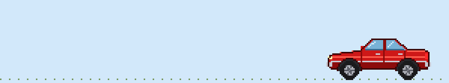

# Carro rojo

Sedán rojo de los 90 dibujado para Mascotas en pantalla (dibujo original, no copiado de ningún juego).

**Qué hace:** conduce de un lado a otro, se da la vuelta en los bordes, toca la bocina, enciende
los faros, echa humo, acelera a toda velocidad (y frena de golpe contra la pared) y se duerme.
Si lo sueltas desde arriba cae y rebota. Al despedirlo con doble toque se va abollando hasta
quedar destrozado y echando fuego.

**Instalarlo:** descarga [`animations.xml`](animations.xml) y en la app pulsa
**Importar mascota (animations.xml)**. También sirve en desktopPet de Windows.

**Cambiarlo:** todo sale de [`generar.py`](generar.py) (dibujos y movimientos). Con Python y
Pillow: `python3 generar.py` vuelve a crear `animations.xml`, `sheet.png`, `icon.png`,
`preview.png` (los 27 dibujos numerados) y `demo.gif`.

| Movimiento | Dibujos |
| --- | --- |
| walk (conducir) | 0, 1, 2 |
| idle, lights, smoke, honk, sleep | 3–9, 25–26 |
| rotate_a / rotate_b (dar la vuelta) | 10, 11 |
| drag, fall, fall soft, fall hard | 13–16 |
| run, bonk (acelerar y frenazo) | 23, 24, 16 |
| kill (destrozo) | 17–22 |
